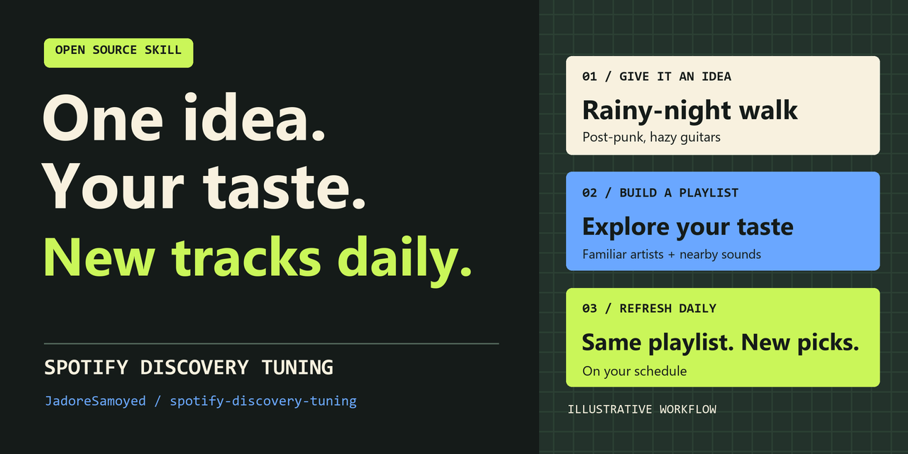

# Spotify Discovery Tuning

**Spotify keeps serving the same songs? Find something you missed by an artist you already love.**

[简体中文](README.zh-CN.md) · [Download the skill](https://github.com/JadoreSamoyed/spotify-discovery-tuning/releases/latest) · [Install in Codex](#install-in-a-codex-project) · [What we tested](evals/README.md)



## Watch the second round change

> **You:** I love Arooj Aftab. I've heard “Mohabbat” too many times. What else should I try?
>
> **Round 1:** [Last Night](https://open.spotify.com/track/3OBkjktMqs7QJ6dOUPWTji), from the same album. Set “Mohabbat” aside for now.
>
> **You:** “Last Night” was new to me and I liked it. Stay with this artist.
>
> **Round 2:** [Suroor](https://open.spotify.com/track/43li6JLxAxfmyVlHIbO9rn) and [Udhero Na feat. Anoushka Shankar](https://open.spotify.com/track/2hFN5GkZ1CNZNRp1tFYWqW). Arooj Aftab stays in the mix. The first round's track stays out.

*Fictional listener feedback, with public Spotify catalog entries.*

## What the skill does

- Separates artist familiarity, track familiarity, and whether a recommendation fits.
- Refines a small batch using concrete feedback instead of restarting from a generic recommendation request.
- Checks recording identity and Spotify links when compatible catalog tools are available, and labels anything it cannot verify.
- Keeps working preferences in the current conversation by default. Saving a preference file or creating or changing a playlist requires an explicit request.

This is a conversational workflow. It does not change Spotify's native recommendation algorithm.

## Install in a Codex project

With Node.js 22.20+ and Git, run this from the project where you want the skill:

```bash
npx skills add JadoreSamoyed/spotify-discovery-tuning --skill spotify-discovery-tuning --agent codex --copy
```

You can also download the release ZIP or review the source and copy the folder manually. Codex loads project skills from `.agents/skills`. [Skills CLI reference](https://www.skills.sh/docs/cli) · [Codex skill guide](https://developers.openai.com/codex/skills/)

<details>
<summary>Bash</summary>

```bash
git clone https://github.com/JadoreSamoyed/spotify-discovery-tuning.git spotify-discovery-tuning-source
cat spotify-discovery-tuning-source/skills/spotify-discovery-tuning/SKILL.md
mkdir -p .agents/skills
cp -R spotify-discovery-tuning-source/skills/spotify-discovery-tuning .agents/skills/
```

</details>

<details>
<summary>PowerShell</summary>

```powershell
git clone https://github.com/JadoreSamoyed/spotify-discovery-tuning.git spotify-discovery-tuning-source
Get-Content -LiteralPath './spotify-discovery-tuning-source/skills/spotify-discovery-tuning/SKILL.md' -Raw
New-Item -ItemType Directory -Force -Path './.agents/skills' | Out-Null
Copy-Item -LiteralPath './spotify-discovery-tuning-source/skills/spotify-discovery-tuning' -Destination './.agents/skills/' -Recurse
```

</details>

The resulting file should be `.agents/skills/spotify-discovery-tuning/SKILL.md`. If the skill does not appear in Codex, restart Codex. Invoke it with:

```text
$spotify-discovery-tuning
Help me find unfamiliar tracks by familiar artists. Start with a small batch,
ask for the artists or tracks you need, and refine it from my feedback.
```

## Catalog access and verification

Live verification requires **compatible Spotify catalog search or lookup tools connected to your agent host**. This repository supplies instructions, not a Spotify connector or credentials.

If the tools are unavailable, the skill asks for a connection or Spotify links and clearly labels the verification status. A supplied link alone is not proof that its contents were checked. You can still discuss what to look for, but unverified candidates must not be presented as verified catalog results.

Catalog verification establishes what a recording is. Your feedback establishes whether it is unfamiliar to you.

## Evidence and scope

See [evaluation notes](evals/README.md) for the available checks and their limits. There is **no measured listener uplift** and no claim that this skill outperforms an ordinary prompt. The demo above illustrates intended behavior, not a listening experiment.

[MIT license](LICENSE). Independent community project; not affiliated with Spotify or OpenAI.

If this helped you find a track you want to hear again, star the repo so you can find it later. If the second round missed, a short report with the prompt and outcome helps us improve it. [Share feedback](https://github.com/JadoreSamoyed/spotify-discovery-tuning/issues/new)
