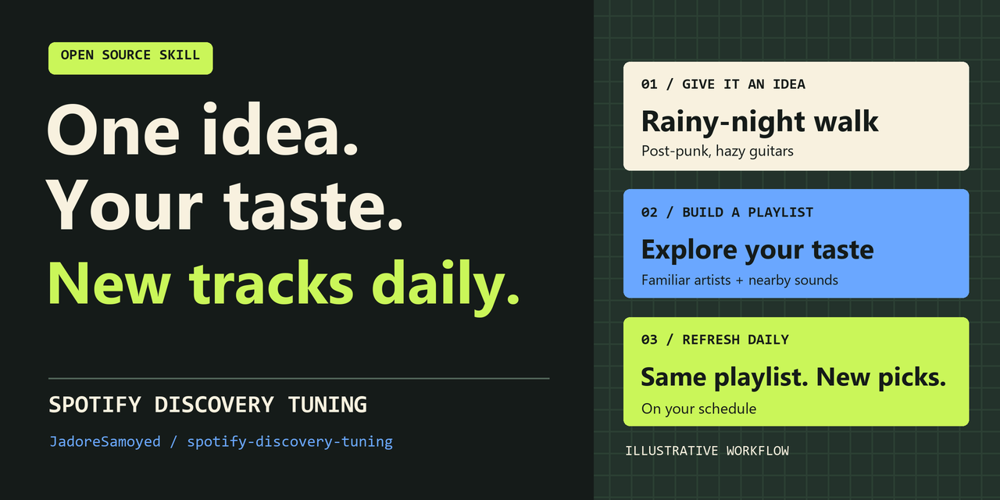

# Spotify Discovery Tuning

**丢一句想法，建一张合你口味、每天有新歌的 Spotify 歌单。**

[English](README.md) · [下载技能](https://github.com/JadoreSamoyed/spotify-discovery-tuning/releases/latest) · [安装](#安装到-codex) · [验证记录](evals/README.md)



## 就这样说

> 给我做一张雨夜走路听的歌单。保留我喜欢的后朋克和朦胧吉他，多挖一点。每天北京时间早上 8:30，往同一张歌单加 5 首。

智能体会沿着你的口味往外找。在这个例子里，可以从熟悉歌手的作品里挖一首 [Primary · The Cure](https://open.spotify.com/track/4fnx6Wman02ryvAOqKm6iI)，再找气质相邻的 [Second Skin · The Chameleons](https://open.spotify.com/track/5F43dz91uj1bQRKDvXbt1f)，也试一首贴近朦胧吉他方向的 [Lorelei · Cocteau Twins](https://open.spotify.com/track/1ZnXuijpwEBjhNxpEnb8WH)。

连接和工具可用时，智能体会按你的要求建一张私密歌单，再为它创建每日任务。每天先去重，再往同一张歌单加歌，保留你已有的曲目。想换口味时，直接说一句「多点贝斯，少点慢歌」，之后的选曲就沿新方向走。

*上面是模拟场景，曲目已在公开曲库核验。示例本身没有创建歌单或任务。*

## 安装到 Codex

已安装 Node.js 22.20+ 和 Git 时，在项目目录运行：

```bash
npx skills add JadoreSamoyed/spotify-discovery-tuning --skill spotify-discovery-tuning --agent codex --copy
```

也可以把[发行版 ZIP](https://github.com/JadoreSamoyed/spotify-discovery-tuning/releases/latest)解压到项目的 `.agents/skills`，确保有 `.agents/skills/spotify-discovery-tuning/SKILL.md`。连接 Spotify，在该项目的 Codex 对话里输入 `$spotify-discovery-tuning`，接上你的选歌想法。

| 想做什么 | 需要什么 |
| --- | --- |
| 先看推荐 | 可以查询 Spotify 曲库 |
| 建歌单 | 可以创建和追加 Spotify 歌单，或有可用的歌单生成工具 |
| 每天自动更新 | 定时环境也能读取该技能、访问同一个已授权歌单并保留私人运行记录 |

在建歌单的同一句话里加上「每天更新」，就可以同时请求建歌单和定时。Codex 需要有可用的定时任务功能，依赖本地文件的任务运行时需要电脑和 App 在线。配置后可在定时任务页面检查首次运行。[Codex 定时任务](https://learn.chatgpt.com/docs/automations?surface=app)

[技能正文](skills/spotify-discovery-tuning/SKILL.md) · [每日刷新规则](skills/spotify-discovery-tuning/references/daily-refresh.md)

[MIT 许可证](LICENSE)。如果它帮你做出一张想长期听的歌单，欢迎点 Star，或者分享你给智能体的那句想法。[反馈入口](https://github.com/JadoreSamoyed/spotify-discovery-tuning/issues)
